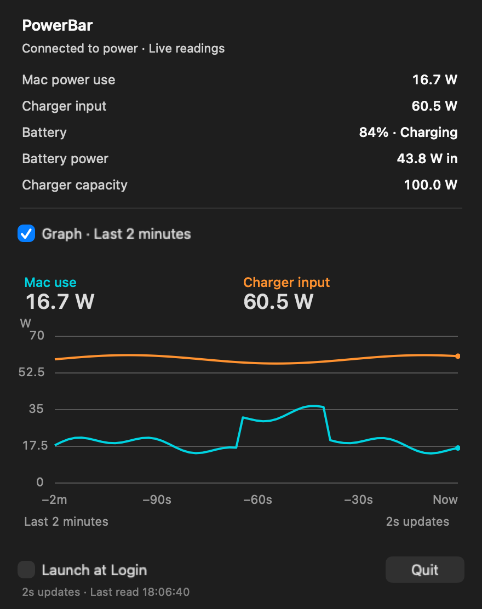

# Mac Power Bar

A small macOS menu bar app that shows how much power your charger is supplying and how much your Mac is using.

While plugged in, the menu bar shows both readings: `⚡ 60.5 W · ↘ 16.7 W`. On battery, it shows power use only. Click for details, then toggle **Graph** to expand the last two minutes of readings in the same pane.



*Preview with sample readings, rendered from the app's own views.*

## Build and run

Requires an Apple silicon Mac, macOS 13 or later, and Xcode Command Line Tools.

```sh
git clone https://github.com/standon99/Mac-Power-Bar.git
cd Mac-Power-Bar
zsh build.sh
open build/PowerBar.app
```

Move `PowerBar.app` into Applications if you want to keep it. **Launch at Login** is optional and off by default. The local build is ad-hoc signed, not notarised.

## How it works

- Reads live charger input and whole-Mac power use every two seconds.
- Updates on plug/unplug events. Briefly shows `… W` while readings settle.
- Keeps two minutes of history in memory. No history files or network requests.
- Pauses sampling when the display or Mac sleeps. Only draws the graph while it is open.

Charger input is DC power entering the Mac, including battery charging. It is different from the charger's rated capacity and power measured at the wall.

The app reads the SMC's `PDTR` and `PSTR` sensors. If those are unavailable, it falls back to macOS battery telemetry, which can update much more slowly. These sensor interfaces are undocumented, so support may vary between Macs and macOS versions.

## Development

Swift, AppKit and a small read-only IOKit bridge. No external dependencies.

```sh
zsh test.sh                    # Build and run the reading/history checks
zsh scripts/render-preview.sh # Rebuild the README image with sample data
```

Sensor references: [Stats](https://github.com/exelban/stats/blob/master/Modules/Sensors/values.swift) and [Chromium's SMC reader](https://chromium.googlesource.com/chromium/src/+/refs/tags/137.0.7151.1/components/power_metrics/smc_mac.mm).
